# ESP-NOW repeater heads

A LoRa repeater with the ESP-NOW bridge can serve small touch-screen "heads"
next to it: ESP-NOW-only MeshCore companions that chat through the repeater,
administer it from the screen, and show what the repeater hears (the CYD and
the Freenove head run the same pages).

```text
                LoRa mesh
                    |
        +-----------+------------+
        |  LoRa repeater         |   ThinkNode M5 (ESP32-S3)
        |  + ESP-NOW bridge      |   set espnow.enabled on, bridge.format raw
        |  + observer feed (opt) |   set espnow.observer on
        +-----------+------------+
                    |  ESP-NOW (2.4 GHz, one channel, raw MeshCore packets
                    |           + observer frames when enabled)
        +-----------+-------------------------+
        |                    |                |
  ESP-NOW relay(s)      CYD head        Freenove head
  (DevKit, optional)    chat + admin + HOME/TELEMETRY/MAP/NODES pages
  repeats MeshCore      from the observer feed (same page code;
  packets               CYD 320x240 in bands, Freenove 480x320)
```

1. **Bridge transports.** The repeater's ESP-NOW bridge carries MeshCore
   packets between LoRa and ESP-NOW. Heads and relays are ordinary MeshCore
   nodes whose only radio is ESP-NOW.
2. **Observer reports** (optional, off by default). The repeater also sends
   compact records of every LoRa packet it receives plus vitals every 5 s.
   These are not MeshCore packets and never enter the mesh.
3. **Head displays and controls.** The head chats and administers the repeater
   over the mesh (login / CLI), and draws the observer feed.

## Branches

All branches are based on `keymindCascade` (`236d12610`; espnow-head, observer-udp and transport-udp are merged up to `ec1d4891e`). Pull in this order;
each one builds on the previous:

```text
espnow/bridge-improvements -> espnow/observer-feed -> head/cyd -> head/freenove -> head/cyd-hmi
espnow/observer-feed -> espnow/observer-udp;  head/cyd-hmi + espnow/observer-udp -> head/transport-udp
m5/hold-actions   (independent)
espnow-head       (everything above combined, plus this file)
```

| Branch | Pull it for | Depends on |
|--------|-------------|------------|
| `espnow/bridge-improvements` | Bridge awake/TX power, `get espnow.nodes` node table, ESP32 DevKit ESP-NOW-only relay env, `espnow.repeat` / `espnow.repeat.gap`, ThinkNode M5 status page extras (backlight button, GPS switch, DMS position, ESP-NOW node count) | upstream |
| `espnow/observer-feed` | `set espnow.observer`: ObserverFrame codec, ObserverRateLimiter, VitalsWindow, receive-path demux on ESP-NOW primary nodes | bridge-improvements (same bridge code paths) |
| `m5/hold-actions` | ThinkNode M5: user-button hold runs the page action (home page: flood advert) instead of power off (`REPEATER_UI_HOLD_ACTIONS`); bold e-ink fonts (`EINK_BOLD_FONTS`) | upstream |
| `head/cyd` | CYD ESP-NOW head (`variants/cyd_espnow_head`), ui-new head screens (compose, admin console, repeater picker, login, presets, settings, keyboard), head contact policy, BaseChatMesh hooks, NVS identity backup | observer-feed |
| `head/freenove` | Freenove FNK0104N visual head (`variants/freenove_s3_35_head`, `ui-freenove/`), chats list/threads, relay-name store, UI test env, fonts with licences, screenshots | head/cyd |
| `head/cyd-hmi` | The visual head's pages on the CYD: screen profile (`HMI_PROFILE_CYD`), strip renderer (320x40 bands, no PSRAM), CYD layouts, HEAD page in the HMI style, chats; keyboard with one mode key (abc / ABC / 123) where every touchable key is drawn; CYD uitest env; CYD screenshots | head/freenove |
| `espnow/observer-udp` | `observer on\|off`, `observer.transport espnow\|udp\|both`: the observer feed over Cascade's UDP bridge too (Observer/Subscribe frame kinds, shared rate limiter, `obs` stats pages), opt-in `ThinkNode_M5_Repeater_bridge_espnow_udp` env | observer-feed (+ keymindCascade) |
| `head/transport-udp` | Heads over ESP-NOW / UDP / both / auto: `HeadLinkRadio`, `transport` + `udp.*` settings, Link page, `docs/espnow-head/udp-transport.md` | head/cyd-hmi + observer-udp |
| `espnow-head` | The combined line used on the owner's devices, plus this document | all |

Each branch builds and passes its host tests on its own; the commit messages
describe each change in detail. `m5/hold-actions` starts with the same
Windows include-path shortener commit for the ThinkNode M5 envs that
`espnow/bridge-improvements` contains (needed to build those envs on
Windows); skip it when both are pulled. `head/cyd` and `head/freenove` each
carry an optional `docs/superpowers/` design/plan commit that can be dropped.
`head/cyd-hmi` changes the shared keyboard for both heads (owner design).
`docs/espnow-head/README.md` summarises the heads.

## Node kinds

### Standalone ESP-NOW nodes

ESP-NOW nodes come in three kinds. They are all ordinary MeshCore nodes
(identity, adverts, contacts, remote admin); only the radio differs.

| Kind | Hardware tested | Env to flash | Radio |
|------|-----------------|--------------|-------|
| LoRa repeater with ESP-NOW bridge | ThinkNode M5 (ESP32-S3) | `ThinkNode_M5_Repeater_bridge_espnow` (any `*_repeater_bridge_espnow`) | LoRa primary, ESP-NOW bridge |
| ESP-NOW-only relay / repeater | ESP32 DevKit | `ESP32Dev_ESPNOW_repeater` (or upstream `Generic_ESPNOW_repeatr`) | ESP-NOW primary (`MESH_PRIMARY_ESPNOW`) |
| ESP-NOW-only companion / head | CYD ESP32-2432S028, Freenove FNK0104N | `CYD_ESPNOW_Head_companion_usb`, `Freenove_S3_35_Head_companion_usb` (or upstream `Generic_ESPNOW_comp_radio_usb`, no screen) | ESP-NOW primary |

`ESP32Dev_ESPNOW_repeater` is `Generic_ESPNOW_repeatr` on a classic DevKit
with channel 6, power saving off by default (ESP-NOW cannot wake the chip from
light sleep) and a 5-minute zero-hop heartbeat advert so a bridge can count
live relays. Floods are repeated with normal MeshCore duplicate suppression,
so several relays and the bridge never loop a packet. The upstream
`Generic_ESPNOW_*` envs (repeater, companion, room server, terminal chat) are
unchanged by these branches and still build.

What they must agree on:

| Setting | Bridge repeater | ESP-NOW-only nodes |
|---------|-----------------|--------------------|
| Channel (1-13) | `set bridge.channel <n>` | `set espnow.channel <n>`, reboot. Default 6 on the DevKit relay and heads, 1 on `Generic_ESPNOW_*` |
| Wire format | `set bridge.format raw` | always raw (plain serialized MeshCore packets) |
| Secret | `bridge.secret` applies to `wrapped` only; ignored in `raw` | none |
| PHY | raw mode turns on the ESP-NOW LR PHY | primary ESP-NOW nodes use the LR PHY |

`wrapped` (magic, checksum, XOR with `bridge.secret`) is only for
bridge-to-bridge links; primary ESP-NOW nodes cannot read it. In `raw`,
MeshCore's own encryption still protects DMs and channel messages; public
frames and routing metadata are visible to anyone on the channel. Raw mode
does not start while the repeater runs a WiFi AP.

How they find each other: there is no pairing. Every node sends to the
ESP-NOW broadcast address by default (`espnow.peer` can pin a unicast MAC) on
the shared channel; anything on that channel with the same format hears it.
Nodes then learn each other through normal MeshCore adverts. A head treats
the repeater it hears at 0 hops over the bridge as its home repeater. On the
bridge repeater, `get espnow.nodes` lists the ESP-NOW stations heard in the
last 15 minutes.

### Hardware

| Device | Role | Status |
|--------|------|--------|
| ThinkNode M5 (ESP32-S3, SX1262) | LoRa repeater + ESP-NOW bridge + observer feed | tested on air |
| Freenove FNK0104N (ESP32-S3, 3.5" ST77922 QSPI, touch) | visual head | tested on air |
| CYD ESP32-2432S028 (ESP32, 2.8" ST7789, XPT2046 resistive touch) | visual head (same pages as the Freenove, 320x240) | tested on air; visual head tested on the device with the observer feed |
| ESP32 DevKit (ESP32-D0WD) | ESP-NOW-only relay | tested on air |
| M5Stack Cardputer ADV | companion; shares the NVS identity backup | build only for this work |
| nRF52 boards (e.g. Heltec T114) | - | not supported: no WiFi, so no ESP-NOW. A future option is an ESP32 attached over UART as an ESP-NOW adapter. |

Build status of the bridge and observer feed on every ESP32-family repeater env (59 of 68 build; build-checked only, on-air verified: ThinkNode M5): [docs/espnow-head/board-matrix.md](docs/espnow-head/board-matrix.md).

## CLI

On the bridge repeater (`docs/cli_commands.md` has the full text):

| Command | Default | What |
|---------|---------|------|
| `set espnow.enabled on\|off` | build dependent | Start or stop the ESP-NOW bridge (`bridge.enabled` on plain bridge images) |
| `set bridge.format raw\|wrapped` | `wrapped` | Use `raw` for heads and ESP-NOW-only nodes |
| `set bridge.channel <1-13>` | build dependent | Must match the heads' `espnow.channel` |
| `set bridge.secret <secret>` | build default | `wrapped` format only |
| `get espnow.status` | | Bridge state, channel, format, `awake=1` when modem sleep is off |
| `get espnow.nodes` | | ESP-NOW stations heard directly in the last 15 min |
| `get espnow.stats [rx\|tx\|drops\|test]` | | Counters (`rep` = repeat copies) |
| `set espnow.peer <MAC>\|broadcast` | broadcast | Fixed unicast destination |
| `set espnow.repeat <1-4>` | `1` | Total copies of every outgoing ESP-NOW frame (edge-of-range links) |
| `set espnow.repeat.gap <0-200>` | `30` ms | Spacing between copies |
| `set espnow.observer on\|off` | `off` | Observer feed for visual heads; admin-only remotely (`set observer on\|off` is the same switch) |
| `set observer.transport espnow\|udp\|both` | `espnow` | Where the feed goes ([transports](#transports-esp-now-default-and-udpip-optional)); `get espnow.stats obs`, `get udp.stats obs` |

On the heads: `set transport espnow|udp|both|auto` and `udp.*` (see
[transports](#transports-esp-now-default-and-udpip-optional)).
On ESP-NOW-only nodes: `set espnow.channel <1-13>` (reboot),
`espnow.repeat` / `espnow.repeat.gap` (companions: local clients only),
`powersaving off` (the default on the heads and the DevKit relay).

## Transports: ESP-NOW (default) and UDP/IP (optional)

ESP-NOW is the default and needs nothing else: no WiFi login on the head,
no router. A head and its repeater can additionally, or instead, talk over
an existing WiFi network through Cascade's WiFi UDP bridge. Both sides opt
in separately; nothing changes for an owner who never sets these.
Full reference, wire format and owner test plan:
[docs/espnow-head/udp-transport.md](docs/espnow-head/udp-transport.md).

> **Before pairing a head over UDP, set a `bridge.secret` on the repeater
> that is not its admin password.** The head keeps the secret unencrypted
> in its NVS. To rotate it: `set bridge.secret` on the repeater, then
> `set udp.secret` on every UDP head (and `bridge.secret` on any bridge using
> `wrapped` format) to the same value; steps in
> [udp-transport.md](docs/espnow-head/udp-transport.md#rotating-bridgesecret).

| Side | Setting | Values (default first) |
|------|---------|------------------------|
| Repeater | `observer on\|off` | `off`; the same switch as `espnow.observer` |
| Repeater | `observer.transport` | `espnow`, `udp`, `both` (one shared rate limit; per-transport counters in `get espnow.stats obs` / `get udp.stats obs`) |
| Head | `transport` (Link page or USB) | `espnow`, `udp`, `both`, `auto` |
| Head | `transport.failover` | `30` s (auto: no ESP-NOW vitals this long -> UDP) |
| Head | `udp.ssid`, `udp.password`, `udp.peer`, `udp.secret`, `udp.port` | WiFi network, repeater IP:port, its `bridge.secret`, head port `4404`; password and secret never shown |

- **Mesh traffic follows the transport**: chat, login and the admin console
  go over ESP-NOW, UDP, both, or (auto) ESP-NOW with fail-over to UDP when
  the repeater's ESP-NOW vitals stop for `transport.failover` seconds, and
  back after 3 vitals in a row and at least 30 s on UDP.
- **Observer frames** are the same bytes on both transports (kind 6 inside
  the UDP bridge framing, only to peers that subscribe). A head receiving
  both shows each frame once (whole-frame hash), so no format change.
- **Channel rule**: ESP-NOW keeps its channel; a station joins WiFi only on
  that channel (Cascade's existing policy, on the repeater's bridge too). A
  network on another channel is not joined and is reported
  (`udp wrong-channel (AP on ch N)`, orange Link page); `both` / `auto`
  (head) and `observer.transport both` (repeater) are refused while the
  access point is known to be elsewhere, with the fix in the reply: move the
  router to the ESP-NOW channel, or move every ESP-NOW node. If the router
  changes channel while joined, the repeater and the heads disconnect from
  WiFi at once and pause UDP (`ap-moved-off-espnow-channel`) instead of
  following it; they rejoin when it is back. Pin the router's channel.
- **Never blocks**: joining is an asynchronous scan of the ESP-NOW channel
  plus WiFi's asynchronous join; retries back off 15 s to 2 min, so LoRa
  receive is never held up by WiFi.
- **Pairing is manual**: the repeater lists the head as `udp.peer.N`
  (head IP from `get transport`), the head stores the repeater's IP:port and
  `bridge.secret`; set `bridge.source tx` and `udp.enabled on` on the
  repeater. Reserve both addresses on the router.
- **Security**: UDP payloads are authenticated (HMAC-SHA256 with
  `bridge.secret`, per-boot handshake, replay window), not encrypted.
  Observer frames carry raw LoRa packets (already on air) plus the
  repeater's vitals and position.
- **Builds**: the heads' product envs include the UDP code
  (`HEAD_UDP_TRANSPORT`; the link object is allocated only outside
  `espnow` mode). The repeater needs a UDP-bridge build; for the M5 the
  opt-in env `ThinkNode_M5_Repeater_bridge_espnow_udp` (the default bridge
  env is unchanged).

## Safety and defaults

- `espnow.observer` is off by default. When off, nothing is sent and mesh
  behaviour is unchanged.
- When on: packet records are rate-limited (20/s, burst 40), dropped while
  mesh traffic is waiting, and kept in a 4-frame outbox (oldest evicted).
  Observer frames never use the bridge TX queue, are never retried, repeated
  or deduplicated, and are ignored by other bridges.
- On ESP-NOW primary nodes observer frames are taken by the demux only when a
  handler is registered (the visual heads). Every other build passes all
  frames to MeshCore as before.
- `espnow.repeat` defaults to 1 (send once, unchanged behaviour). OTA payloads
  are never repeated; copies stop while `radio.mode` disables transmit.
- Heads auto-add only their home repeater from adverts; chat companions are
  saved when you first DM them. Other companions keep their usual auto-add
  settings.
- M5 hold actions and bold e-ink fonts are opt-in build flags, set only for
  the ThinkNode M5.

## Compared with MQTT observers

| | ESP-NOW observer + head | MQTT observer |
|-|-------------------------|---------------|
| Scope | One repeater, local (WiFi range, extended by relays) | Many repeaters, regional aggregation |
| Infrastructure | None: no router, broker or internet | WiFi network, broker, usually internet |
| Direction | Two-way: the head also chats and administers the repeater | Mostly one-way reporting |
| Data | Every received LoRa packet + vitals, live on the device | Packets/metrics to a server for maps and history |
| Use | Field and off-grid sites, a screen next to the repeater | Network-wide monitoring |

They are complementary; a repeater can run both where the build allows.

## What it looks like

### CYD head, 320x240

Real frames from the CYD (`CYD_ESPNOW_Head_uitest`), quiet area; chat
contents are injected test messages, the login field holds masked test
digits, node names are public adverts. No animations on the CYD; fewer
panels (TELEMETRY without the SNR waterfall and ACTIVE NODES, four quick
tiles on HOME, NODES without TYPE / KM).

| | |
|-|-|
| 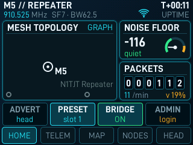 HOME | 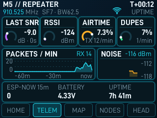 TELEMETRY |
| 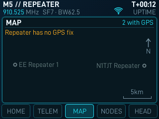 MAP | 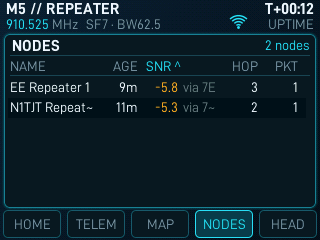 NODES |
| 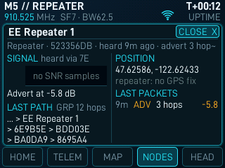 Node card | 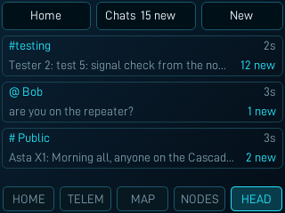 Chats |
| 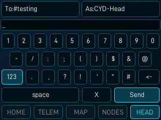 Compose, 123 mode | 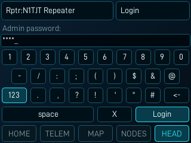 Login (masked) |

How it fits a classic ESP32 without PSRAM: each frame is drawn into one
320x40 RGB565 band buffer (25.6 KB) by replaying the page draw per band;
a band whose pixels did not change is not pushed (idle = nothing pushed).
At most 15 frames/s; a frame takes 43-94 ms (render + push) depending on the
page. The model (64 nodes, 128 packets) lives in internal RAM; about 62 KB
of heap stays free.

The keyboard (both heads): one mode key cycles abc -> ABC -> 123 (phone
layout `1234567890` / `-/:;()$&@` / `.,?!'"#`); `% ^ * + = _ ~ { } [ ] < > \ |`
and the backtick are not on the screen keyboard. On the Freenove the new
keyboard is verified by host previews only (not yet on the glass).

Both heads: the screen turns off 2 minutes after the last touch; the
companion carousel's "Screen" page cycles 30 s / 1 / 2 / 5 min / Never.
Faint chevron tiles mark the carousel's side taps and a scrollable NODES
list or chats conversation list. On the CYD the pages never take more than half of the CPU core the
companion loop runs on, and touch is debounced for the resistive panel.

### Freenove head, 480x320

The real screenshots are from a quiet area (few
nodes); chat contents are injected test messages, passwords are masked, node
names and positions come from public adverts.

| | |
|-|-|
| 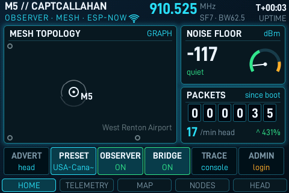 HOME: topology around the home repeater, noise floor, packet counter, quick controls | 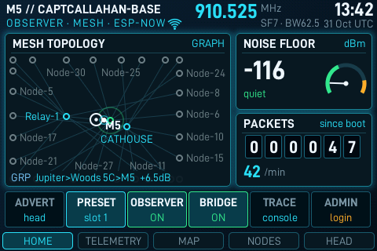 HOME on a busy mesh: rendered by the same page code with sample data (not a device screenshot) |
| 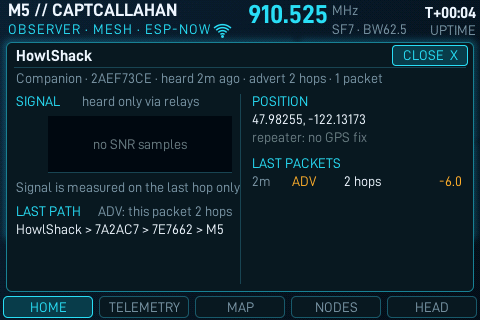 HOME with a node card open | 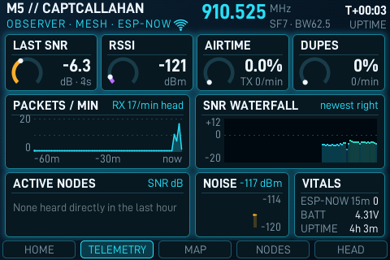 TELEMETRY: repeater vitals |
| 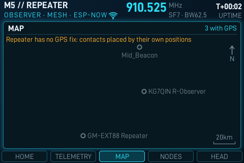 MAP: node positions from adverts | 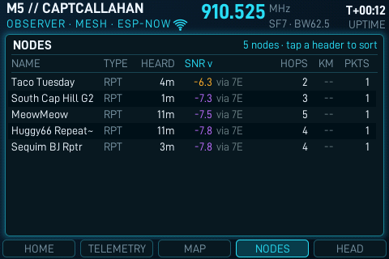 NODES: sortable, SNR and the relay it came through |
| 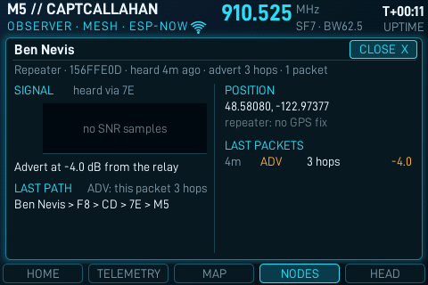 Node detail card | 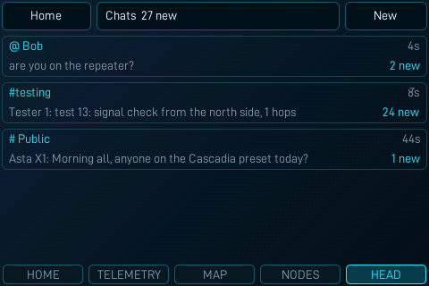 Chats list |
| 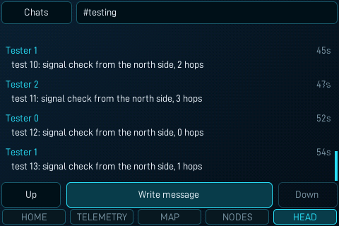 Chat thread | 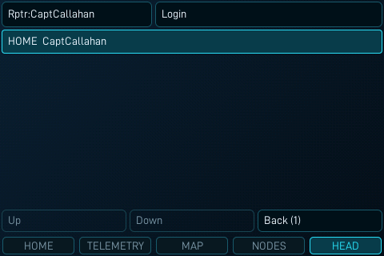 Repeater picker, home repeater first |
| 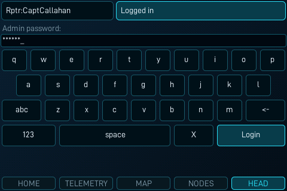 Login (password masked) | 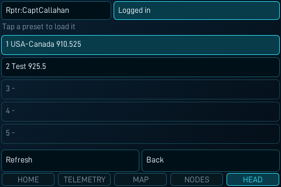 Radio presets |
| 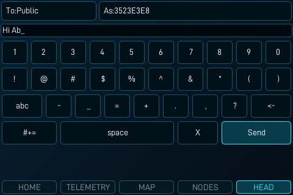 Keyboard (outdated: the layout before the single mode key) | |

## Credits and licences

- MeshCore and the Cascade fork: their existing licences apply to all code
  here.
- D-DIN font (Datto), SIL Open Font License 1.1:
  `examples/companion_radio/ui-freenove/LICENSE.D-DIN-OFL.txt`.
- DejaVu Sans Mono (8x16 bitmap font rendered from it; Bitstream Vera / DejaVu licence):
  `examples/companion_radio/ui-freenove/LICENSE.DejaVu`.
- Font bitmaps are generated by `examples/companion_radio/ui-freenove/tools/`.
