# ESP-NOW repeater heads (CYD and Freenove)

Branches `head/cyd`, `head/freenove` and `head/cyd-hmi`, on top of
`espnow/bridge-improvements` and `espnow/observer-feed`.

A touch head for a LoRa repeater with the ESP-NOW bridge: an ESP-NOW-only
MeshCore companion (`MESH_PRIMARY_ESPNOW`, no LoRa) that chats through the
repeater and administers it from the screen. Both heads also draw the
repeater's observer feed (`set espnow.observer on` on the repeater) on the
same pages: HOME, TELEMETRY, MAP, NODES and HEAD (the companion screens in
the same HMI style). One page codebase (`examples/companion_radio/ui-freenove`)
with two screen profiles: the Freenove draws 480x320 frames in PSRAM, the CYD
(no PSRAM) draws 320x240 frames in 320x40 bands (`HMI_PROFILE_CYD`).

| Head | Env | Setup |
|------|-----|-------|
| CYD ESP32-2432S028 (ST7789 320x240, XPT2046 touch) | `CYD_ESPNOW_Head_companion_usb` | `variants/cyd_espnow_head/README.md` |
| Freenove FNK0104N (ESP32-S3, ST77922 480x320, touch) | `Freenove_S3_35_Head_companion_usb` | `variants/freenove_s3_35_head/README.md` |

On the repeater: `set espnow.enabled on`, `set bridge.format raw`, and
`bridge.channel` equal to the head's `espnow.channel` (default 6); for the
pages also `set espnow.observer on`.

## On-screen keyboard (both heads)

One mode key (left of the third row, labelled with the current mode, lit
when not lower case) cycles abc -> ABC -> 123 -> abc; ABC stays capitals
until cycled. 123 is the phone layout: `1234567890`, `-/:;()$&@`,
`.,?!'"#`. The bottom row is space, X (cancel) and the action key. Not
typeable on screen: `% ^ * + = _ ~ { } [ ] < > \ |` and the backtick (use
the USB terminal for those). Every key that can be touched is drawn; on the
CYD's HEAD page the rows shrink (32 / 36 px) so all four fit.

## CYD screens (320x240)

Real screenshots from the CYD (`CYD_ESPNOW_Head_uitest`, frames as
composed for the panel), quiet area; chat contents are injected test
messages, the login field holds four masked test digits, node names and
positions are public adverts. The CYD has no animations (the route is
highlighted, gauges and counters just update) and shows fewer panels:
TELEMETRY leaves out the SNR waterfall and ACTIVE NODES, HOME has four quick
tiles (ADVERT, PRESET, BRIDGE, ADMIN), NODES has no TYPE and KM columns.

| | |
|-|-|
| 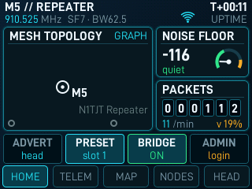 HOME | 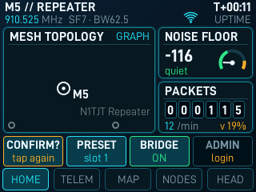 HOME, ADVERT armed (CONFIRM?) |
| 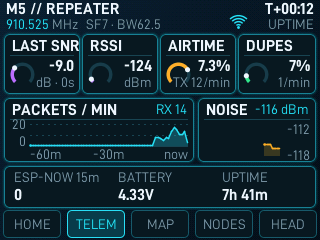 TELEMETRY | 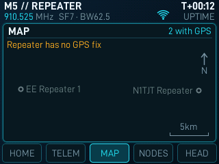 MAP (repeater without a GPS fix) |
| 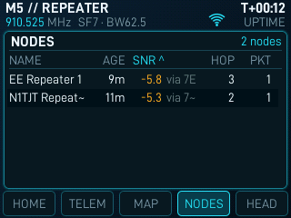 NODES, sorted by SNR | 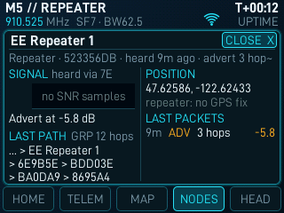 Node card |
| 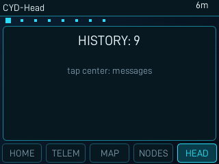 HEAD: companion home | 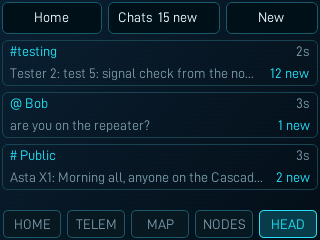 Chats list |
| 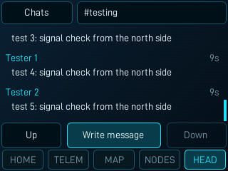 Chat thread | 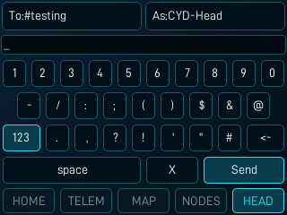 Compose, 123 mode |
| 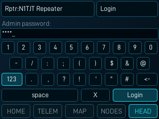 Login entry (masked) | 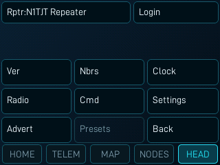 Admin console |
| 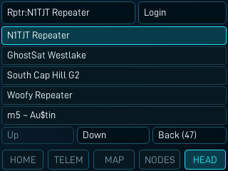 Repeater picker | |

## Freenove screens (480x320)

Freenove head, 480x320. Real screenshots are from a quiet area (few nodes);
chat contents are injected test messages, passwords are masked, node names
and positions are public adverts. The busy HOME image is rendered by the same
page code with sample data (`test/test_layouts.py --preview`), not taken
from a device.

| | |
|-|-|
| 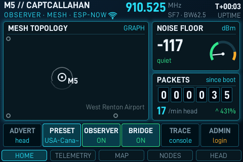 HOME: topology around the home repeater, noise floor, packet counter, quick controls | 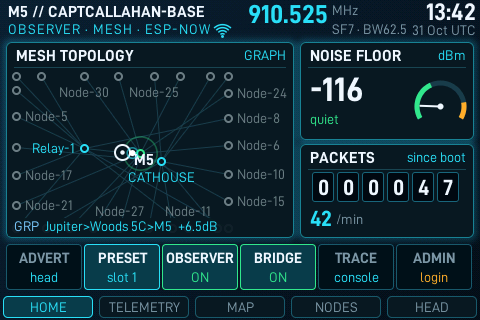 HOME on a busy mesh: rendered by the same page code with sample data |
| 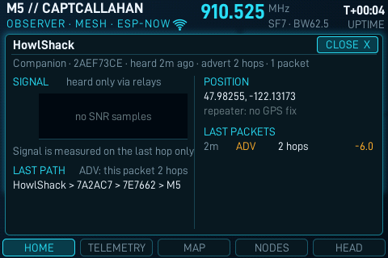 HOME with a node card open | 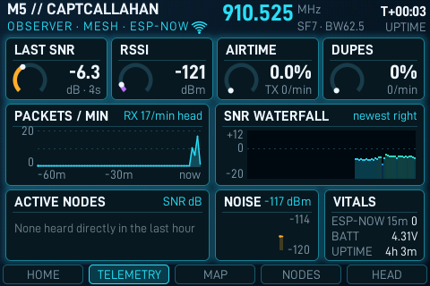 TELEMETRY: repeater vitals |
| 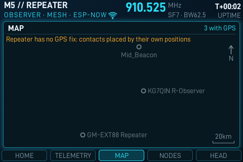 MAP: node positions from adverts | 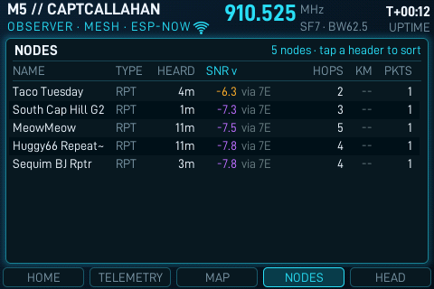 NODES: sortable, SNR and the relay it came through |
| 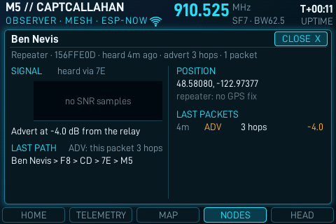 Node detail card | 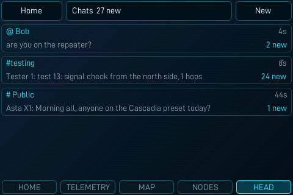 Chats list |
| 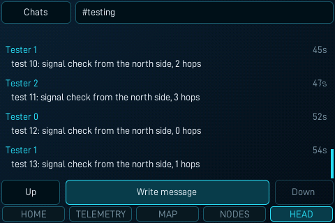 Chat thread | 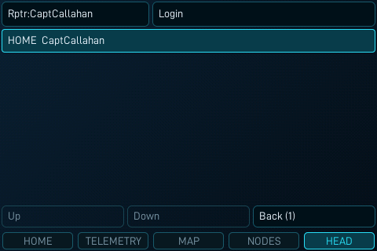 Repeater picker, home repeater first |
| 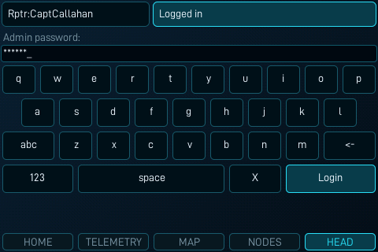 Login (password masked) | 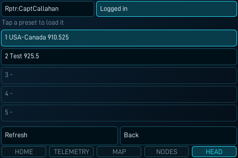 Radio presets |
| 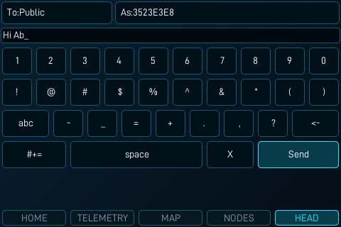 Keyboard (outdated: the layout before the single mode key, see above) | |
